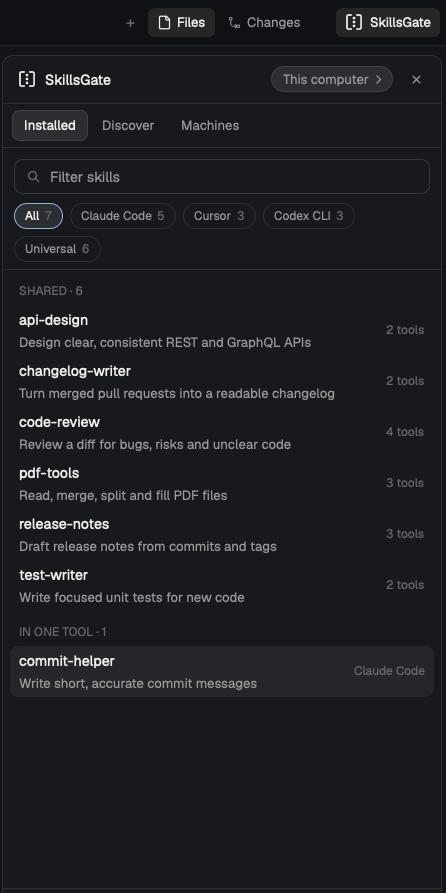

# SkillsGate for Herdr

A mod for [Herdr](https://herdr.dev), the desktop app for coding agents. It adds a SkillsGate button to Herdr's tab bar and a panel beside your work area that manages your AI coding-agent skills.

A skill is a folder with a `SKILL.md` file of instructions for a coding agent. SkillsGate keeps each skill once, in `~/.agents/skills`, and links it into the skills folder of each coding tool that should use it.



The panel has three tabs:

- **Installed** lists the skills on the machine you are viewing, filtered by name or by tool. Open one to read its `SKILL.md`, switch it on or off for each tool, or delete it.
- **Discover** searches the public [skills.sh](https://skills.sh) catalog and installs a skill from GitHub into the tools you pick.
- **Machines** lists this computer and every machine Herdr reaches over SSH. The panel follows the machine of the space you are looking at, or you can pick one.

Every change acts only on the machine being viewed. A skill installed here also appears in the SkillsGate desktop app, with its source.

## What it needs

- Herdr 0.1.15 or later.
- `git` on a machine, to install skills there. Without it the panel still lists and manages skills, and says that installs are off.
- macOS or Linux machines. Windows machines are not supported.

## Install

Paste this into an agent in Herdr:

```text
Read ~/.config/herdr-app/AGENTS.md, then add this mod from https://github.com/skillsgate/skillsgate/tree/main/herdr/skillsgate. Follow its RECIPE.md: add only the SkillsGate toggle and panel to my current layout and keep everything else as it is. Reuse existing SkillsGate nodes instead of duplicating them.
```

The agent reads [`RECIPE.md`](RECIPE.md) and every file before it adds anything, and it should tell you what the mod touches (below). It copies the mod to `~/.config/herdr-app/mods/skillsgate` and adds two nodes to your layout, `skillsgate-toggle` and `skillsgate-panel`.

## What it touches

- **It runs programs.** It runs short `sh` scripts on the machine you are viewing, which use `awk`, `cp`, `dirname`, `find`, `head`, `ln`, `mkdir`, `mktemp`, `mv`, `rm` and `sort`, and `git` for installs.
- **It reaches the network.** It calls `skills.sh` to search and `raw.githubusercontent.com` to preview a skill, from your computer. An install runs `git clone` from `github.com` on the machine being viewed.
- **It reads and writes outside its own folder.** It reads every coding tool's skills folder, and it creates, replaces and removes skill folders and links in `~/.agents/skills` and in each tool's skills folder. It also reads and updates `~/.agents/.skill-lock.json`, which records where installed skills came from. This happens on your computer and on each Herdr machine you use it on.

A delete removes a skill's folder only after the script has checked that it is a real skill folder inside a skills folder. An install replaces a folder of the same name in `~/.agents/skills`, and the install dialog says so first.

## Remove it

Delete `~/.config/herdr-app/mods/skillsgate`, and delete the two layout nodes `skillsgate-toggle` and `skillsgate-panel` from your layout file. Skills you installed or linked stay where they are.

## For contributors

See [`../AGENTS.md`](../AGENTS.md). The tests run with `npm run test:herdr` from the root of the SkillsGate repository.
