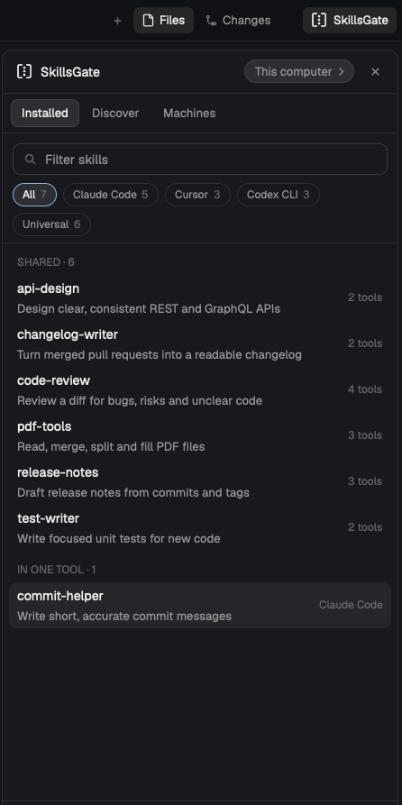

# SkillsGate

A button at the right end of Herdr's tab bar opens a panel beside the work area that lists the AI coding-agent skills on this computer and on every machine Herdr reaches over SSH. A skill is a folder that holds a `SKILL.md` file of instructions for a coding agent. SkillsGate keeps each skill once, in a shared folder (`~/.agents/skills`, called the shared store here), and links it into the skills folder of each coding tool that should use it (Claude Code, Cursor, Codex CLI and 22 others). The panel shows which skills each tool has, adds a skill to a tool or removes it with a switch, deletes a skill, and installs new ones from the public [skills.sh](https://skills.sh) catalog, on the machine being viewed. The mod runs programs and writes into skill folders outside its own folder; "What it touches" in Built from lists exactly what.



## What you see

All sizes are in px at zoom 1; Herdr applies the person's zoom. All colors are Herdr theme tokens, and text follows the person's UI font size: base is `settings().ui_font_size` (13 when unset), the title is base + 2, small text is base - 1, tiny is base - 2 and micro is base - 3.

**The button.** A block 118 wide at the right end of the tab bar's row, after the tabs. It shows the 16 mark (`mark.svg`: two square brackets with three dots between them) and the word "SkillsGate" in small text. It is a 26 high rounded control: muted text on the chrome color, with the `selected` background and the foreground color while the panel is open, and the `hover` background under the pointer. The block has the chrome background and a bottom border.

**The panel.** A column 400 wide (it can be resized from 380 to 720) at the right of the work area. Inside it is one card with 10 rounded corners, a 1 border, the `background` color and the foreground text color. Top to bottom:

- A 44 high header: the mark, "SkillsGate" in semibold, a flexible gap, a pill, and a 26 close button. The pill is 24 high, fully rounded, at most 200 wide, with a border, the `raised` background and muted small text. It names the machine being viewed ("This computer" or the machine's name) and ends with a small chevron. A click on it opens the Machines tab.
- A 40 high tab row with three tabs, **Installed**, **Discover** and **Machines**. Each tab is 28 high with 7 rounded corners. The open one has a border and the `raised` background and the foreground color; the others are muted.
- A 34 high status line, only while work runs or a notice shows. Work in progress shows a turning refresh icon and the text in muted. A done notice shows a check mark in the `done` color. A warning shows a 7 dot in the `blocked` color. An error shows a 7 dot in the `ansi1` color. The text is one line and is cut with an ellipsis.
- The tab's body, which fills the rest. Only a list inside it scrolls (with Herdr's thin scrollbar); the header, tabs, fields and footer stay put.
- A 32 high footer with a top border. At the left, in tiny `dim` text: "7 skills · 4 tools · checked 20s ago" (the tools counted are the ones that have a skill; "Checking…" before the first result). At the right, a Refresh button, 24 high, with a 13 refresh icon that turns while a scan runs.

**Installed** (the viewed machine's skills):

- A 32 high filter field with a search icon and the placeholder "Filter skills". Its border turns to the accent color while it has focus. It matches a skill's name, folder name or description, ignoring case.
- A wrapping row of 24 high chips: "All" with the total, then one chip per tool that has a skill, in the registry's order, each with its count (for example "Claude Code 5"). Universal, the tool whose folder is the shared store, reads "Universal". A click filters the list to that tool; a second click on the same chip, or "All", clears it.
- The list, in up to three sections with a small semibold `dim` label and a count: "SHARED · 6" (the skill's folder is directly inside the shared store), "IN ONE TOOL · 1" (a real folder inside one tool's own skills folder, or inside a grouping folder of the shared store) and "LINKED FROM ELSEWHERE · 1" (a tool links to a folder outside every skills folder). Skills are sorted by name without case.
- Each row is 46 high: the skill's name, and under it its description in muted small text (one line, cut with an ellipsis). At the right, in tiny `dim` text, "3 tools" or, when only one tool has it, that tool's name. A click opens the skill dialog.
- With a filter that matches nothing: "No skills match". With no skills at all: "No skills on this computer yet" (or "on <machine>") and a primary "Browse skills" button that opens Discover. While a machine has never had a result: six placeholder rows that pulse. If its first scan failed: the error text and a Retry button.

**Discover** (the public skills.sh catalog):

- A search field with the placeholder "Search skills.sh" and a turning icon at its right while a search is on its way.
- A label, "POPULAR" while the field holds fewer than two characters (the catalog is then searched for `skill`) and "RESULTS" otherwise.
- Rows 46 high: the skill's name, `owner/repo` under it in muted small text, an "Installed" tag (a check mark on a small rounded tag in the `done` color) when the viewed machine's shared store already has the folder this skill would install to, and the install count in tiny `dim` text, written like "950", "229.7k" or "1.2M". A result that cannot be installed is dimmed and does nothing when clicked. Any other row opens the catalog dialog.
- No results: `No skills found for "<text>"`. A failed search: "Can't reach skills.sh" or "skills.sh search failed (HTTP <status>)", with a Retry button.

**Machines:**

- A 44 high first row, "Follow the shown space", with a switch at the right (36 by 20, the accent color when on).
- Below it a scrolling list with one card per machine: this computer first, then the others by name without case. A card has a 7 status dot (green when it has been scanned, red when it failed, gray while it first loads), the name in semibold, a "Viewing" tag on the machine being viewed (the card's border turns to the accent color), "7 skills · 4 tools", up to three tags with the tools that have the most skills, and one line when something is wrong: "Can't reach <machine>", "git is not installed, so installs are off", or, for a machine without a POSIX shell, "<machine> has no POSIX shell. SkillsGate for Herdr supports macOS and Linux machines." While a machine's first scan runs the card pulses.

**The skill dialog** (760 by 560, drawn by the mod as its own card with 12 rounded corners, the `popover` background and a border):

- A 64 high header with the skill's name (title size, semibold), under it the skill's folder written with `~` for the home folder, a dot and the machine's name, and a close button.
- A 40 high tab row: **Document** and **Tools 3** (the count is the number of tools that have the skill).
- Document: the skill's description in muted text, then its `SKILL.md` rendered as selectable Markdown without its frontmatter (the block between two `---` lines at the top). A `SKILL.md` that cannot be read says "Couldn't read SKILL.md: <reason>".
- Tools: one 44 high row for each tool detected on that machine, plus any tool that already has the skill, in the registry's order: the tool's own Herdr mark (16) or, without one, a two-letter badge; its name; and a 36 by 20 switch. The Universal row has no switch and says "Shared copy". For a skill that is not directly in the shared store there are no switches; a note above the rows says why ("Only skills in the shared store can be added to other tools. This one lives in Claude Code's own skills folder." or "... This one is linked from ~/somewhere, outside every skills folder.") and a check mark ends each row of a tool that has the skill.
- A 56 high footer: a "Delete skill" button at the left (text and border in the `ansi1` color, a trash icon, and filled with that color once armed; "Remove from all tools" for a skill linked from elsewhere), the machine's running work in the middle with a turning icon, and a primary "Done" button at the right.

**The catalog dialog** (760 by 560, same card): a header with the skill's name, `owner/repo`, a dot and "229.7k installs", and a close button. Below it, two panes. At the left, the skill's `SKILL.md` from GitHub: the description in muted text, then the Markdown without its frontmatter ("Loading preview…", then "Preview unavailable" when it cannot be fetched). At the right, 250 wide with a left border, a pane headed "ADD TO TOOLS" with one 36 high checkbox row for each tool detected on the machine except Universal (mark, name, a 16 box that fills with the accent color and a check when checked) and, under a top border, the line "The shared store (~/.agents/skills) always gets a copy." The 56 high footer has a Cancel button and a primary button, "Install on this computer" or "Install on <machine>" ("Update on ..." when the shared store already has that folder). While the install button is disabled, the reason is written at the left of the footer; when it would replace a folder it says in the `blocked` color "<folder> is already in the shared store. Installing replaces it."

## How it behaves

The mod shows no agent status and reacts to none.

**Show and hide.** The button runs `layout.toggle` and the header's close button runs `layout.hide`, both on the layout node `skillsgate-panel`. Whether the node is hidden belongs to the layout, so it survives a switch of space and a restart. A hidden panel starts no scan, search or timer work.

**Which machine is viewed.** By default the panel follows the shown space: it views the machine that space lives on (this computer, or a machine Herdr reaches over SSH). A click on a card on the Machines tab views that machine and opens Installed; following stays off until "Follow the shown space" is switched back on. Switching it off keeps viewing the machine shown at that moment. The choice is kept in Herdr's shared store.

**Reading.** A scan lists every tool's skills folder in one shell script run on the machine. The viewed machine is scanned when the panel shows, every 30 s while it shows, on Refresh and after every change. While Machines shows, every machine is scanned when the tab opens and every 60 s after, each in its own task, so a machine that hangs until its 30 s timeout never holds up another; Refresh on that tab scans all of them. Rows stay on screen while a scan runs, and after a failed re-scan: once a machine has had one good scan, a later failure keeps its rows and says once, in an error notice, "Can't check <machine>: <reason>" ("this computer" for the local one); the same reason is not said again. The footer's "checked ... ago" is "just now" under 10 s, then counts in steps of 10 s ("10s ago" to "50s ago"), then "1m ago" and "1h ago". The panel redraws once a second only when something it shows would read differently.

**Add to a tool** (a switch turned on in the skill dialog). Makes a relative symbolic link, in the tool's skills folder, to the skill's folder in the shared store. It replaces a link of that name that is already there, refuses with `A different copy of "<folder>" is already in <Tool>` when a real folder has that name, and removes its own new link and says `Could not link "<folder>" into <Tool>` if the link does not lead to a folder holding `SKILL.md`. It creates the tool's skills folder when it is missing.

**Remove from a tool** (a switch turned off). Removes that tool's link only; the shared copy stays. A tool that holds its own real copy refuses: `<Tool> holds its own copy of "<name>". Delete the skill to remove it.` The Universal row has no switch.

**Delete skill.** The first click arms the button for 4 s and it reads "Click again to delete"; a second click in that time removes every link that leads to the skill's folder and then the folder. It first checks that the folder is a real folder, not a link, that it is inside the skills folder that holds it, and that it holds `SKILL.md`; if the disk changed since the scan it deletes nothing and says `"<name>" changed on disk. Refresh and try again.` A skill linked from elsewhere loses its links and keeps its folder ("Remove from all tools"). Deleting a skill from the shared store also drops its entry from the lock file (below), without a notice if that fails.

**Install** (the primary button of the catalog dialog). On the machine being viewed: `git clone --depth 1` of `https://github.com/<owner>/<repo>.git` into a temporary folder; the skill is looked for in the clone, first match wins: `skills/<id>`, `skills/.curated/<id>`, `skills/.experimental/<id>`, `<id>`, then any `*/<id>/SKILL.md`, then any `SKILL.md` whose frontmatter has `name: <id>`, and last the repository root (a repository that is one skill). The folder it installs to is the id lowercased, with every run of characters outside `a-z 0-9 . _` turned into one `-` and leading and trailing `-` trimmed. The skill is copied into `<shared store>/.skillsgate-new.<folder>` (a hidden staging folder), checked, and then replaces `<shared store>/<folder>`. A repository's symbolic links are never followed or installed: a `SKILL.md` counts only as a regular file, and a skill whose copy holds any link is refused with `"<id>" in <owner>/<repo> contains symbolic links and was not installed`. Then the skill is linked into the checked tools (as Add to a tool does), and its source is recorded in the lock file `~/.agents/.skill-lock.json`: the desktop SkillsGate app reads the same file, so it shows the source. The lock is left byte for byte as it was, and the notice says so as a warning ("Installed, but the skill lock was not updated (<reason>)", the reason being `invalid`, `large`, `unreadable` or `changed`), when it is not valid JSON, is not a version 1 lock, would pass 96 KiB, cannot be read, or appeared while the install ran; an absent lock is created. The checked tools of the last install are remembered per machine; before the first install they are every detected tool that already has a skill, except Universal. The dialog closes at once and the panel's status line reports the work and the outcome. Other failures say `git is not installed on <machine>`, `Could not download <owner>/<repo>` or `Could not find "<id>" in <owner>/<repo>`.

**One request at a time per machine.** A dialog never changes anything itself, because a dialog's background work stops when it closes. It posts a request to Herdr's shared store and only the panel carries it out. The panel takes the machine's lock (the status line shows its text: "Adding code-review to Cursor on vps…", "Removing ... from ...", "Deleting <name>...", "Removing <name> from all tools...", "Installing <name>..."; the machine's name is left out for this computer), scans the machine again so the operation acts on the disk as it is now and not on an older scan, runs the operation, releases the lock, scans again, raises the machine's revision so open dialogs read again, and says the outcome: "Added <name> to <Tool>", "Removed <name> from <Tool>", "Deleted <name>", "Removed <name> from all tools", "Installed <name>" or "Updated <name>" (when the shared store already had that folder). A request for a machine that is busy is refused with the warning "<Machine> is busy. Try again when it finishes."; a skill that is gone from the fresh scan says "That skill is no longer on <machine>." and a machine that cannot be scanned says "Can't check <machine>: <reason>", and nothing runs in either case. A lock that is not refreshed for 150 s is treated as released; it is refreshed after the fresh scan and before each step of an install, so a long install never loses it. While a machine is busy, or the dialog is still waiting for the outcome of what it sent, the dialog's switches, delete button and Install are disabled. Machines are independent: work on one runs beside work on another.

**Notices.** A done notice stays 4 s; a warning or an error stays 8 s. Work in progress shows instead of a notice.

**Keys and pointer.** Escape closes a dialog. Dialogs are opened by a click on a row (Installed or Discover). The mod ships no `keys.json`.

**Discover timing.** A search starts 300 ms after the last keystroke and asks for 30 results. It runs only while Discover shows in a shown panel; the result of a search for text that is no longer in the field is dropped, and the last outcome stays on screen while a newer search runs.

**Rendered Markdown** (the skill's `SKILL.md`, in both dialogs) is selectable. A click on a link opens it only when it is an absolute `http` or `https` link with a host; any other link does nothing. Text over 200,000 characters is cut there, a code block open at the cut is closed, and a last line says "Shortened: only the first 200,000 characters are shown."

## Built from

### What it touches

Say all three to the person before adding the mod.

1. **It runs programs.** Every read and write on a machine is a POSIX `sh` script started through Herdr's `exec`, on this computer or, with `on`, on a Herdr machine. The scripts use `sh`'s own commands and these programs: `awk`, `cp`, `dirname`, `find`, `head`, `ln`, `mkdir`, `mktemp`, `mv`, `rm`, `sort`, and `git` (only for installs, and a missing `git` only turns installs off). `rm -rf` runs only on a skill folder the same script has just checked, on the install's own temporary and staging folders and on the folder an install replaces.
2. **It reaches the network.** The panel calls `https://skills.sh/api/search` for Discover and fetches a skill's `SKILL.md` from `https://raw.githubusercontent.com/<owner>/<repo>/HEAD/...` for the catalog dialog, both from this computer through Herdr's `fetch`. An install runs `git clone` of `https://github.com/<owner>/<repo>.git` on the machine being viewed.
3. **It reads and writes outside its own folder.** It reads every coding tool's skills folder and each skill's `SKILL.md`, and it creates, replaces and removes skill folders and links in the shared store (`~/.agents/skills`) and in each tool's skills folder, and it reads and rewrites `~/.agents/.skill-lock.json`, on this computer and on every Herdr machine it is used on. It never touches the desktop app's own database.

### Files

One mod, `mods/skillsgate/`, with `mod.json` `{ "place": "none", "title": "SkillsGate", "focusable": true }`. To test the logic modules under `node --test`, a `package.json` with `{ "private": true, "type": "module" }` must sit in a folder above the mod, so `node` reads its `.js` files as modules (Herdr itself does not need it; the SkillsGate monorepo has one at `herdr/package.json`). One mod copy plays one role, chosen by `props().role`: none (the panel), `toggle`, `skill` (props `{ role, on, key }`: the machine's name or null, and the skill's real path) or `catalog` (props `{ role, on, row: { source, skillId, name, installs } }`).

Views draw with Herdr's UI kit and may import Herdr:

| File | Owns |
|---|---|
| `main.js` | picks the role's view; its header comment lists every file |
| `host.js` | the adapters over Herdr (`exec`, `readText`, `fetch`), the channel, machine and catalog built on them, the window facts (is the panel node hidden, which machine is viewed) and the ids of requests already taken |
| `ui.js` | `SIZE`, `textSizes()` and the widgets several views share (buttons, tabs, switch, dialog card, tool mark, skeleton rows, spinner, status line, Markdown view) |
| `toggle.js` | the tab-bar button |
| `panel.js` | the frame, the timers, the request loop and the per-machine data |
| `installed-tab.js`, `discover-tab.js`, `machines-tab.js` | the three tabs |
| `skill-dialog.js`, `catalog-dialog.js` | the two dialogs |

Logic modules import no Herdr (Herdr's functions come in as arguments), so `node --test` covers them:

| File | Owns |
|---|---|
| `registry.js` | the 25 tools as data (below) |
| `scripts.js` | every `sh` script, as strings |
| `model.js` | the data: frontmatter, scan parsing, grouping into skills, paths, the lock, names and labels |
| `view-model.js` | what each view shows: sections, chips, texts, the Machines cards, the dialogs' decisions |
| `machine.js` | scan and the four operations (link, unlink, remove, install) on one machine |
| `catalog.js` | the skills.sh search, the GitHub preview and the checks on a source and a skill id |
| `channel.js` | requests, the per-machine lock, notices and revisions, in Herdr's shared store |
| `requests.js` | the body of the panel's request loop |

Art: `mark.svg` (16 by 16, one color through `currentColor`: two brackets drawn as rounded 1.5 strokes, three dots between them) and `icons/` with `close`, `search`, `refresh`, `check`, `trash` and `chevron-right`, each a 16 by 16 SVG with a 1.5 stroke. The mod loads them as `mods/skillsgate/mark.svg` and `mods/skillsgate/icons/<name>.svg`.

### Add to the existing window

The mod is a piece for the person's own window; it adds two layout nodes and does not replace the layout.

1. Do not edit a layout Herdr ships. If the layout in use is one of Herdr's, clone it first (Herdr's own `AGENTS.md` says how) and add the nodes to the clone. If it is the person's own, edit it.
2. Keep every node that is not SkillsGate's exactly as it is.
3. Search the layout for nodes whose `content.mod` is `skillsgate`. If `skillsgate-toggle` and `skillsgate-panel` already exist, reuse them and add nothing. Never add a second copy.
4. Add the toggle as the last child of the row that holds the `tabs` block, so it sits at the right end of the tab bar:

```json
{
  "id": "skillsgate-toggle",
  "type": "block",
  "content": { "mod": "skillsgate", "props": { "role": "toggle" } },
  "size": { "px": 118 }
}
```

5. Add the panel as the last child of the row that holds the work area (`main`), next to the layout's own side panel if it has one:

```json
{
  "id": "skillsgate-panel",
  "type": "column",
  "size": { "px": 400 },
  "min": 380,
  "max": 720,
  "children": [
    { "id": "skillsgate", "type": "block", "content": { "mod": "skillsgate" } }
  ]
}
```

6. Keep the panel's column out of the per-space `panel` stack (the column whose children are the Files and Changes blocks). The stack shows one child at a time and is hidden per space, which would make the SkillsGate panel come and go with the space. The panel needs its own column node so `layout.show`, `layout.hide` and `layout.toggle` can address it by id.
7. Copy `mods/skillsgate/` to `~/.config/herdr-app/mods/skillsgate`, leaving the recipe and the preview out. If that name is taken, rename the folder and the `mod` names in the two nodes. Run `herdr-app check` on the folder.

The working example is a clone of Herdr's `main` layout in which the toggle is the second child of the `tabs-row` row (after `tabs`, which has weight 1) and the panel is the last child of `work-body`, after Herdr's own `panel` column. Herdr's own `panel` column carries `"hidden": true`; the same field on `skillsgate-panel` would start it closed.

### What it calls

From `herdr`: `exec` (as `exec("sh", ["-c", script, "skillsgate", ...args], { on, timeout })`), `readTextFile(path, { on })`, `shared` and `setShared`, `spaces()` (the active space's `machine`), `machines()` (a machine's `layout` is `"unavailable"` when it cannot be reached), `layout()` (to find the panel node and its `hidden`), `run("layout.toggle" | "layout.hide", { id: "skillsgate-panel" })`, `openOverlay({ mod: "skillsgate", kind: "dialog", frame: "none", width: 760, height: 560, props })`, `closeOverlay`, `props()`, `theme()`, `settings()` and `knownAgents()` (for the tools' marks). From `gpui-kit`: `View`, `div`, `svg`, `image`. From `gpui-base`: `h_flex`, `v_flex`, `Input`, `InputState`, `Switch`, `Checkbox`, `Scrollbar` and `TextView.markdown`. The global `fetch` is used for skills.sh and GitHub. Herdr's shared keys, each ending `.v1`: `skillsgate.request.v1`, `skillsgate.busy.v1`, `skillsgate.notice.v1`, `skillsgate.rev.v1` (per machine), `skillsgate.machine.v1` (`{ follow, on }`) and `skillsgate.targets.v1` (per machine). A machine is keyed by its name, or by the empty string for this computer.

### The registry

`registry.js` holds, for each of the 25 tools, `name`, `displayName`, `shortCode`, `dir` (its global skills folder), `detect` (folders whose presence means it is installed) and `program` (a key in Herdr's program table, for the mark, when there is one). `dir` and `detect` are `sh` expressions that the scan script expands on the machine it runs on. Order matters: it is the order of the chips and of the tool rows, and `universal` is last.

| name | displayName | shortCode | dir | detect | program |
|---|---|---|---|---|---|
| claude-code | Claude Code | CC | `${CLAUDE_CONFIG_DIR:-$HOME/.claude}/skills` | `${CLAUDE_CONFIG_DIR:-$HOME/.claude}` | claude |
| cursor | Cursor | CU | `$HOME/.cursor/skills` | `$HOME/.cursor` | cursor |
| github-copilot | GitHub Copilot | GC | `${XDG_CONFIG_HOME:-$HOME/.config}/github-copilot/skills` | `${XDG_CONFIG_HOME:-$HOME/.config}/github-copilot` | copilot |
| windsurf | Windsurf | WS | `$HOME/.windsurf/skills` | `$HOME/.windsurf` | |
| cline | Cline | CL | `$HOME/.cline/skills` | `$HOME/.cline` | |
| continue | Continue | CN | `$HOME/.continue/skills` | `$HOME/.continue` | |
| codex-cli | Codex CLI | CX | `${CODEX_HOME:-$HOME/.codex}/skills` | `${CODEX_HOME:-$HOME/.codex}` | codex |
| droid-cli | Droid CLI | DR | `${FACTORY_HOME:-$HOME/.factory}/skills` | `${FACTORY_HOME:-$HOME/.factory}` | |
| ob-1 | OB-1 | OB1 | `${OB1_HOME:-$HOME/.ob1}/skills` | `${OB1_HOME:-$HOME/.ob1}` | |
| amp | Amp | AM | `$HOME/.amp/skills` | `$HOME/.amp` | amp |
| goose | Goose | GO | `$HOME/.goose/skills` | `$HOME/.goose` | |
| junie | Junie | JU | `$HOME/.junie/skills` | `$HOME/.junie` | |
| kilo-code | Kilo Code | KC | `$HOME/.kilo-code/skills` | `$HOME/.kilo-code` | |
| opencode | OpenCode | OC | `$HOME/.opencode/skills` | `$HOME/.opencode` | opencode |
| openclaw | OpenClaw | OW | `$HOME/.openclaw/skills` | `$HOME/.openclaw`, `$HOME/.clawdbot`, `$HOME/.moltbot` | |
| pear-ai | Pear AI | PA | `$HOME/.pear-ai/skills` | `$HOME/.pear-ai` | |
| roo-code | Roo Code | RC | `$HOME/.roo-code/skills` | `$HOME/.roo-code` | |
| trae | Trae | TR | `$HOME/.trae/skills` | `$HOME/.trae` | |
| zed | Zed | ZD | `${XDG_CONFIG_HOME:-$HOME/.config}/zed/skills` | `${XDG_CONFIG_HOME:-$HOME/.config}/zed` | |
| qoder | Qoder | QD | `$HOME/.qoder/skills` | `$HOME/.qoder` | qoder |
| qoder-cn | Qoder CN | QC | `$HOME/.qoder-cn/skills` | `$HOME/.qoder-cn` | |
| qwenpaw | QwenPaw | QP | `$HOME/.qwenpaw/skill_pool` | `$HOME/.qwenpaw` | |
| zcode | ZCode | ZC | `$HOME/.zcode/skills` | `$HOME/.zcode` | |
| muse-code | Muse Code | MC | `${XDG_CONFIG_HOME:-$HOME/.config}/muse/skills` | `${XDG_CONFIG_HOME:-$HOME/.config}/muse` | muse |
| universal | Universal (.agents/skills) | UA | `$HOME/.agents/skills` | `$HOME` | |

A tool's name in the panel is its display name without a trailing note in parentheses, so "Universal (.agents/skills)" reads "Universal". A tool counts as present on a machine when any `detect` folder exists.

### The scripts

All are in `scripts.js`. Values that come from a machine, the catalog or the person are passed as positional arguments (`$1`...); only registry expressions are written into script text. Scripts do not use `realpath`, `readlink -f`, `jq`, `node`, `basename`, `tr`, `cat`, `xargs`, `ls`, `echo`, or bash syntax. A real path is `$(cd -P -- "$dir" && pwd -P)`. Timeouts: 30,000 ms for a scan and for each small operation, 120,000 ms for an install.

- **Scan** (no arguments). Sets `HOME` to its real path, appends `/opt/homebrew/bin:/usr/local/bin` to `PATH`, and prints records ended by `\x1e` with fields separated by `\x1f`: `H`, home and whether `git` exists (`1` or `0`); `T`, one per tool in registry order, with the tool's name, its skills folder (real path when it exists, else the expression expanded under the real home) and whether it is detected; `S`, one per skill folder found, with the tool's name, the entry's path, its real path, whether the entry is a link (`1` or `0`) and the `SKILL.md` frontmatter block (at most 80 lines, with `\x1e` and `\x1f` removed). A folder counts when it holds `SKILL.md`; a folder without one is treated as a grouping folder and its children are listed one level down. A skill's `home` is `store` when its real path is a direct child of the shared store, `tool` when it is inside any tool's folder, and `external` otherwise; the skills are those grouped by real path.
- **LINK** `<tool folder> <folder name> <relative target>`. Creates the folder, refuses (exit 3) when a real file or folder has that name, replaces an existing link, makes the link and checks that it leads to `SKILL.md` (else removes it, exit 5). Bad arguments exit 2.
- **UNLINK** `<entry path> <expected real path>`. Removes the entry only when it is a link that resolves to the expected folder; exit 3 when it is a real folder, a dangling link or a link elsewhere.
- **REMOVE** `<real path> <base folder or -> <entry path>...`. The second argument is an absolute base folder that equals its own real path, or the single character `-` (links only, never `rm -rf`); anything else, including an empty one, exits 2 before anything changes. With a base folder it requires that the target is a real folder, not a link, strictly inside the base, holding `SKILL.md` (else exit 4). It removes each entry that is a link resolving to the target, then the folder.
- **INSTALL** `<clone URL> <skill id> <store folder> <folder name>`. Checks every argument first (exit 64): the URL starts with `https://` or `file:///`, the skill id is letters, digits, `.`, `_` and `-` and does not start with `.` or `-`, the store is absolute, and the folder name is not empty, `.` or `..`, has no `/` and does not start with `.` or `-`. Exits 127 without `git`. Sets `GIT_TERMINAL_PROMPT=0` and `GIT_ALLOW_PROTOCOL=https:file`, clones with `git clone -q --depth 1` into a folder made by `mktemp -d` named `skillsgate-herdr.XXXXXX` (exit 2 when the clone fails), and searches in the order given under Install. Every folder it picks must resolve to the clone's real root or a path inside it, and the picked `SKILL.md` must be a regular file that is not a link (exit 5 when nothing is found). It copies with `cp -R <src>/. <staging>/`, removes the `.git` inside, requires `<staging>/SKILL.md`, exits 7 when the copy holds any symbolic link, removes a link or folder at the destination and moves the staging folder into place. A stale staging folder from a killed run is removed first. It prints the destination. On any exit it removes its temporary and staging folders.
- **WRITE** `<path> <text> <new|replace>`. Writes the lock: the text goes to `<path>.skillsgate-tmp.<pid>` made with a plain redirect (its mode follows the umask) and is moved over the target, so a reader sees the old file or the new one. `new` exits 3 when something is already at the path; `replace` means the caller has just read the file. Empty text, a relative path, a path ending in `/` or any other third argument exits 2.

The lock is a JSON file `{ "version": 1, "skills": { "<folder>": { "source": "<owner>/<repo>", "sourceType": "github", "originalUrl": "<owner>/<repo>", "skillFolderHash": "", "installedAt": "<ISO time>", "updatedAt": "<ISO time>" } } }`, written with two-space indentation. An existing entry keeps its `installedAt`. The text travels to the machine as one argument, which Linux caps at 128 KiB, so a lock over 96 KiB is left alone; the size is counted in UTF-8 bytes by hand.

A skill's name and description are read from the frontmatter at the top of its `SKILL.md`: `name` and `description`, plain, quoted, folded (`>`) or literal (`|`); a value that continues on indented lines is joined with single spaces. The name falls back to the folder's name.

## Watch out

- **Keep the panel out of the per-space `panel` stack.** It needs its own column node, `skillsgate-panel`, as in Built from; Herdr's layout commands address a node by its id.
- **No shared writes and no `cx.notify()` during render.** Render may start work only with `cx.spawn(async (cx) => { await cx.sleep(0); ... })`. Never keep a `cx` past its callback. Never pass `null` to `.child`; use `.when(Boolean(x), ...)`. There is no `setTimeout`; use `cx.timer.every`, `cx.timer.after` and `cx.sleep`. Herdr redraws the whole window on every notify, so a timer notifies only when something it shows would change.
- **`writeTextFile`, `watchFolder` and `fs/promises` work on this computer only.** Every read and write on a machine goes through `exec("sh", ...)` and `readTextFile(path, { on })`. Herdr keeps empty arguments and a 98,304-character argument intact, here and on a remote macOS machine.
- **Herdr's JavaScript runtime has no `TextEncoder`, no `structuredClone` and no `Intl`.** `localeCompare` ignores its options (it sorts by code unit) and `toLocaleString` does not group digits. Sort with explicit lower-casing and format numbers by hand (the install count, the UTF-8 length of the lock). `node --test` cannot catch this, so keep these out of the code and comment any helper that would reach for them. It does have `Object.hasOwn`, `Array` `at`, `findLast`, `toSorted` and `flatMap`, `String` `replaceAll` and `matchAll`, `Promise.allSettled`, `URL`, `fetch`, `encodeURIComponent`, and regular expressions with lookbehind, named groups and Unicode.
- **Inside a mod, `settings().ui_font_size` is the size at zoom 1** (13 here with zoom 1.1), while `herdr-app status` reports it already zoomed (14.3). Herdr zooms a mod's sizes itself, so use the value as it is; dividing it by the zoom draws text 10% too small.
- **A field of a view class must not share a method's name.** `this.key = ...` in `init` hides a method named `key`, so a handler that calls it throws. The tests check this by reading the source text.
- **`herdr-app check` renders once.** It runs the default role (the panel) and cannot see the toggle, a dialog, or any keyboard path. Check those in the window. No command opens a dialog; click a row. `herdr-app do <mod>.<command>` reaches shown copies only, so a hidden panel receives nothing. `herdr-app shot` right after a `do` can return the previous frame; wait a moment.
- **Saving the mod re-runs `init`**, so the panel's own state (its tab, its filter) resets on every save.
- **The single request slot.** `skillsgate.request.v1` holds one request and the latest wins. That is why a dialog disables its actions while its machine is busy, and why only the panel role listens for requests. A panel copy ignores a request that was already in the store when it started, and copies of one build share the list of taken ids, so a second panel copy never runs a request the first one took.
- **`h_flex()` centers its children on the cross axis.** A column in a row takes its content's height unless the row has `items_stretch()` (or the child `h_full()`); without it a scroll area made of `absolute().inset_0()` children collapses to zero height.
- **`Switch` and `Checkbox` from `gpui-base` come unstyled.** Style the track, the knob, the box and the colors yourself. `Switch.on_change` receives `(checked, cx)`.
- **Errors from `exec` and `readTextFile` start with the Herdr function's name** ("`herdr.exec`: ", "`herdr.readTextFile`: "); the Machines card strips the first. A program that cannot start reads "cannot run <program>: ..." on this computer and "cannot start <program>: ..." on a remote one; a timeout reads "<program> took longer than <n> s and was stopped" (with " on <machine>" for a remote one); an unknown machine rejects at once with `unknown machine "<name>"`. Mod code wraps `exec` so it never rejects: a failure comes back as code -1 with the reason in stderr. `readText` resolves `null` only for an absent file and rejects on any other failure, and a lock that cannot be read is never written over.
- **Windows machines are not supported.** The scripts need a POSIX shell. A machine without one shows its card with the message under Machines; the other machines keep working. The mod is written for macOS and Linux machines.
- **Quotes and spaces in paths.** A skill folder named `it's odd name`, or a home folder with a space, must scan, link, unlink and delete like any other, which is why values travel as arguments. The disk may change between a scan and a click (the desktop app or a command line may move or delete a skill); an operation then refuses and changes nothing, never deletes a different folder.
- **Limits.** The status line is one line. A skills.sh search asks for 30 results. A skill's frontmatter is read from at most 80 lines. Rendered Markdown is capped at 200,000 characters. A shell script argument holding the lock is capped at 96 KiB.
- **It assumes** Herdr 0.1.15 or later (`exec` takes `timeout`), `git` on a machine for installs there, and `sh`, `awk`, `find` and the other programs above on every machine. The global skills only: a repository's own `.claude/skills` folders are not listed. There is no way to copy a skill from one machine to another, to edit or create a skill, or to see a skill's supporting files.

## Done when

1. `herdr-app check ~/.config/herdr-app/mods/skillsgate` passes and the `errors` field of `herdr-app status` is empty.
2. The layout holds exactly one `skillsgate-toggle` and one `skillsgate-panel`, the toggle is in the tab bar's row and the panel is not inside the `panel` stack, and every node that was there before is still there.
3. `herdr-app do layout.show --id skillsgate-panel` shows a 400 wide panel and the button turns `selected`; `layout.hide` hides it and the button returns to muted; the button and the header's close button do the same by click. A hidden panel starts no `sh` process (watch with `ps`).
4. With the panel shown, the Installed tab lists this computer's skills in the three sections, each row with its name, its one-line description and "n tools"; the footer reads "n skills · m tools · checked just now" and the time moves in steps of 10 s; typing in the filter narrows the list; a click on a tool's chip filters it; a click on a row opens the 760 by 560 skill dialog with Document and Tools tabs, and Escape closes it.
5. Discover shows "POPULAR" with rows, typing two or more letters shows "RESULTS", and with the network off it shows "Can't reach skills.sh" and a Retry button.
6. The Machines tab shows this computer's card and one card for each Herdr machine; a click on a card changes the pill in the header to that machine and returns to Installed. If a machine is unreachable its card says why and the others stay green.
7. In a temporary home (never the real one), each script gives the results in "The scripts": the scan lists a skill folder named `it's odd name`; LINK refuses (exit 3) when a real folder has the name; UNLINK refuses (exit 3) a link that became a real folder; REMOVE refuses (exit 4) when `SKILL.md` is gone and (exit 2) an empty base folder; INSTALL from a local repository (a `file:///` URL) copies a skill, refuses a repository link (exit 7) and leaves the lock untouched when it is invalid JSON. The repository's tests do this in a temporary home and the whole suite (`npm run test:herdr` in the SkillsGate monorepo) passes.
8. No file in the mod folder uses `TextEncoder`, `structuredClone`, `Intl`, `setTimeout`, `writeTextFile`, `watchFolder` or `fs/promises`, and none of the logic modules imports `herdr`, `gpui-kit` or `gpui-base`.
